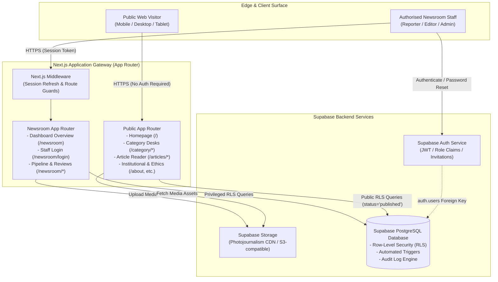

# Systems & Application Architecture
## Coastline Reporters News Publishing Platform

---

## 1. High-Level Architectural Diagram



---

## 2. Frontend Application Architecture

### 2.1 Next.js App Router Structure
The application adopts Next.js App Router with React Server Components (RSC) by default for zero-bundle-cost data rendering and search engine optimization.

```
src/
├── app/
│   ├── layout.tsx              # Root Layout: Masthead, Header, CategoryNav, BreakingBanner, Footer
│   ├── page.tsx                # Homepage: BBC-inspired StoryGrid layout
│   ├── globals.css             # Tailwind CSS v4 design tokens and typography
│   ├── icon.tsx                # Dynamic Edge SVG brand favicon
│   ├── about/                  # Institutional: Mission & Editorial Board
│   ├── contact/                # Institutional: News Bureaus & Whistleblower channel
│   ├── editorial-policy/       # Ethics: Multi-source verification & independence
│   ├── corrections-policy/     # Ethics: Transparent corrections and retractions
│   ├── privacy-policy/         # Legal: NDPA compliance & zero ad trackers
│   ├── coastline-tv/           # Phase 5 Multimedia: Video portal placeholder
│   ├── podcasts/               # Phase 5 Multimedia: Audio desk placeholder
│   ├── category/[slug]/        # Dynamic Category Desk route (10 desks)
│   ├── articles/[slug]/        # Article Reader with specimen verification badge
│   └── newsroom/               # Protected Staff Dashboard Surface
│       ├── layout.tsx          # Newsroom Staff Control Bar & Navigation
│       ├── page.tsx            # Dashboard Overview & Publishing Lifecycle
│       ├── login/              # Staff Authentication & Invitation Gateway
│       ├── articles/           # Article Publishing Pipeline (Phase 3 placeholder)
│       ├── reviews/            # Peer Review & Clearance Desk (Phase 3 placeholder)
│       ├── media/              # Media Assets Repository (Phase 3 placeholder)
│       └── settings/           # Access Control & Audit Log settings
├── components/
│   ├── brand/                  # CoastlineLogo, CoastlineEmblem
│   ├── layout/                 # Masthead, Header, CategoryNav, BreakingBanner, Footer
│   ├── news/                   # ArticleCard, StoryGrid, SpecimenNotice
│   └── ui/                     # Reusable design system primitives
├── lib/
│   ├── constants/              # Navigation, Editorial Desks, Specimen Data
│   ├── supabase/               # Client, Server, and Middleware Supabase helpers
│   └── utils/                  # Formatting, Date, and Slugs
└── types/                      # TypeScript schemas for Article, Profile, Role, AuditLog
```

---

## 3. Backend & Data Storage Architecture

### 3.1 PostgreSQL Database Layer
- **Engine:** Supabase PostgreSQL 15+.
- **Zero-Trust Data Isolation:** Row-Level Security (RLS) is enabled on all 11 core database tables. Public visitors possess read access strictly to published stories (`status = 'published'` AND `published_at <= NOW()`).
- **Audit Logging Engine:** All state modifications, editorial reviews, and role changes generate tamper-resistant records within `public.audit_logs`.

### 3.2 Authentication & Invitation Workflow
- Newsroom staff access is decoupled from public registration. Public user self-signup is disabled.
- Newsroom accounts are provisioned exclusively through secure administrator invitation tokens.
- Role checks are evaluated server-side against the `public.user_roles` table, preventing client-side privilege escalation.

---

## 4. Hosting & Deployment Evaluation (Zero-Budget Tier)

In alignment with Section 3 and Section 5 of the Master Development Instructions, free-tier hosting alternatives have been evaluated for commercial compliance, bandwidth allowances, and serverless compute limits:

| Platform | Free Tier Allowances | Commercial Use Policy | Fit for Coastline Reporters |
| :--- | :--- | :--- | :--- |
| **Vercel Hobby** | 100 GB Bandwidth, Edge Middleware, Next.js native optimization | Restricted to non-commercial personal projects. Commercial news publishing requires Pro (\$20/mo/seat). | **Prototyping Only.** Cannot serve as long-term zero-budget commercial host without risk of Terms of Service violation. |
| **Cloudflare Pages / Workers** | Unlimited static bandwidth, 100k daily serverless worker requests | **Fully allows commercial projects** on free tier. Highly resilient DDoS protection (Cloudflare CDN). | **Recommended Production Host.** Outstanding edge caching and no commercial prohibition on free tier. |
| **Netlify Free** | 100 GB Bandwidth, 300 build minutes/month | Allows commercial use under fair use limits. | **Viable Alternative.** Good fallback option. |
| **Supabase Free Tier** | 500 MB database, 1 GB file storage, 50,000 monthly active users | **Permits commercial projects** within quotas. Pauses after 1 week of inactivity (can be mitigated with scheduled ping). | **Recommended Database & Auth.** Ideal for Phase 1–4 zero-budget operational MVP. |
