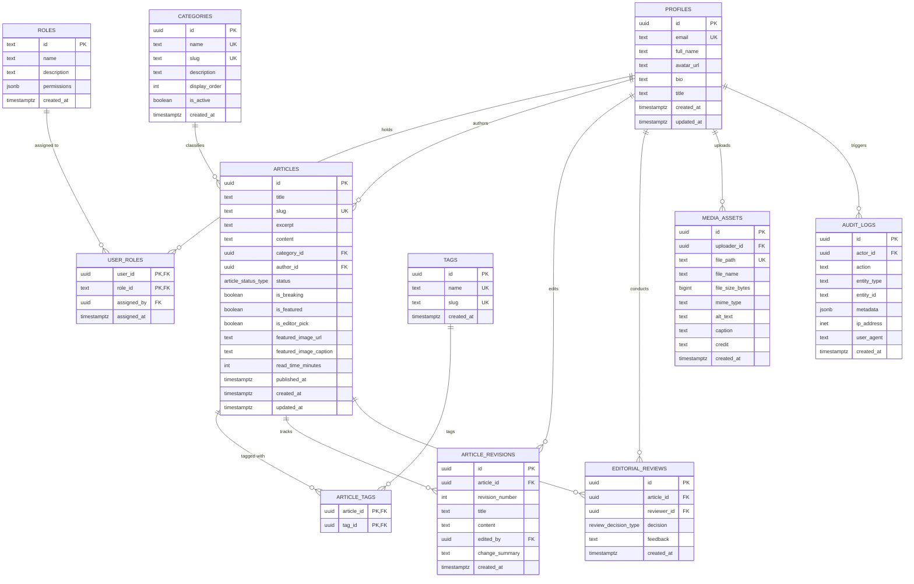

# Database Schema & Data Dictionary
## Coastline Reporters PostgreSQL Architecture

---

## 1. Entity-Relationship Diagram (ERD)

---

## 2. Table Dictionaries & Schema Definitions

### 2.1 `profiles`
Stores public-facing journalistic credentials and newsroom biographical metadata. Linked 1:1 with `auth.users(id)`.
- `id` (UUID, Primary Key): Foreign key referencing `auth.users(id) ON DELETE CASCADE`.
- `email` (TEXT, Unique, Not Null): Official contact email.
- `full_name` (TEXT, Not Null): Reporter or editor byline name.
- `avatar_url` (TEXT): Profile photo hosted on Supabase Storage.
- `bio` (TEXT): Journalistic bio, field areas, and bureau assignments.
- `title` (TEXT): Official newsroom designation (e.g. *Senior Maritime & Environmental Reporter*).

### 2.2 `roles` & `user_roles`
Implements normalized Role-Based Access Control (RBAC).
- `roles.id` (TEXT, Primary Key): Unique slug identifier (`super_admin`, `admin`, `editor_in_chief`, `managing_editor`, `section_editor`, `reporter`, `multimedia_producer`).
- `roles.permissions` (JSONB): Granular permission array (e.g. `["articles:create", "articles:publish"]`).
- `user_roles` (Junction Table): Associates newsroom users with roles. Composite Primary Key `(user_id, role_id)`.

### 2.3 `categories`
Defines the 10 approved editorial news desks.
- `id` (UUID, Primary Key): Unique category identifier.
- `name` (TEXT, Unique, Not Null): Desk display name (e.g., *Niger Delta*, *Environment*).
- `slug` (TEXT, Unique, Not Null): URL route slug (`niger-delta`, `environment`).
- `display_order` (INT): Navigation ribbon sequencing.
- `is_active` (BOOLEAN): Soft toggle for editorial desks.

### 2.4 `articles`
The core editorial publishing entity.
- `id` (UUID, Primary Key): Unique article identifier.
- `slug` (TEXT, Unique, Not Null): Clean URL slug generated from headline.
- `status` (ENUM): State machine: `draft` | `pitch` | `under_review` | `revision_requested` | `approved` | `published` | `archived`.
- `is_breaking` (BOOLEAN): Toggles appearance in breaking news ticker banner.
- `is_featured` (BOOLEAN): Toggles homepage Lead Hero positioning.
- `is_editor_pick` (BOOLEAN): Toggles placement in Editorial Focus sidebar.
- `published_at` (TIMESTAMPTZ): Enforced by table constraint: must be non-null if `status = 'published'`.

### 2.5 `article_revisions` & `editorial_reviews`
Maintains journalistic revision history and fact-checking sign-offs.
- `article_revisions`: Sequential snapshots of article text (`revision_number`, `edited_by`, `change_summary`).
- `editorial_reviews`: Peer review log (`reviewer_id`, `decision`: `approved` | `rejected` | `changes_requested`, `feedback`).

### 2.6 `media_assets` & `audit_logs`
- `media_assets`: Metadata repository for photojournalism, satellite imagery, and video files uploaded to Supabase Storage.
- `audit_logs`: Tamper-evident operational trail tracking actions, actor UUID, IP address, and payload metadata.

---

## 3. Row-Level Security (RLS) Policy Matrix

| Table | Operation | Public / Anonymous | Newsroom Reporter | Newsroom Editor / Admin |
| :--- | :--- | :--- | :--- | :--- |
| `articles` | SELECT | Only `status = 'published'` & `published_at <= NOW()` | Can view all states | Can view all states |
| `articles` | INSERT | Denied | Allowed (author_id = auth.uid()) | Allowed |
| `articles` | UPDATE | Denied | Only own drafts in `draft`/`pitch` | Can edit, approve, & publish |
| `categories` | SELECT | `is_active = true` | Allowed | Allowed |
| `roles` / `user_roles` | SELECT / ALL | **Denied** | **Denied** | Only Admins & Super Admins |
| `audit_logs` | SELECT | **Denied** | **Denied** | Only Admins & Super Admins |
| `article_revisions` | SELECT | **Denied** | Allowed for staff | Allowed for staff |
| `editorial_reviews` | SELECT / INSERT| **Denied** | Can read own article reviews | Can review and sign-off |
