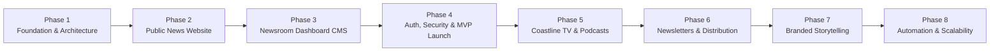

# Master Development Roadmap
## Coastline Reporters Strategic Engineering Phases

---

## Roadmap Overview

Coastline Reporters follows an 8-phase progressive engineering lifecycle designed to ensure editorial independence, zero-budget infrastructure sustainability, and enterprise security.

---

### Phase 1: Foundation, Design System, Database & Auth Architecture (Current)
*Status: Complete & Verified*
- **Deliverables:**
  - Next.js application with TypeScript and Tailwind CSS.
  - Complete brand visual system: bird-and-wave emblem, Coastline logo, typography tokens, BBC-inspired information hierarchy.
  - Initial routing structure: 10 editorial desks, article reader, institutional pages, and newsroom control layout.
  - PostgreSQL database schema migrations covering 11 entities with strict Row-Level Security (RLS) policies.
  - Auth architecture for newsroom staff with separation from public visitors.
  - Comprehensive 8-document architectural documentation suite.

---

### Phase 2: Public-Facing News Website
*Status: Scheduled (Requires approval before commencing)*
- **Primary Goals:**
  - Connect public pages to live Supabase PostgreSQL queries using React Server Components.
  - Real-time client-side and full-text server-side search indexing across articles and categories.
  - Dynamic social share preview cards (`openGraph` image generator).
  - RSS / Atom feed generator for national and international syndication.
  - Reading progress bar, estimated reading time calculators, and font-size accessibility adjustments.

---

### Phase 3: Multi-User Newsroom Dashboard & Editorial Publishing System
*Status: Scheduled*
- **Primary Goals:**
  - Rich-text block editor with support for pull quotes, data callouts, image galleries, and embedded charts.
  - Editorial pipeline kanban view: Pitch &rarr; Draft &rarr; Under Review &rarr; Approved &rarr; Published.
  - Review desk interface: Inline paragraph comments, fact-checking verification checkboxes, and editorial sign-off.
  - Photo desk & media asset manager: Direct Supabase Storage uploads, automated WebP optimization, and EXIF sanitization.
  - Revision history diff viewer comparing sequential article revisions.

---

### Phase 4: Authentication Completion, Security Testing & MVP Production Deployment
*Status: Scheduled*
- **Primary Goals:**
  - Live Supabase Auth integration with cryptographic invitation tokens and password recovery workflows.
  - End-to-end security penetration testing: RLS policy verification, SQL injection checks, CSRF protection, and rate limiting.
  - Production environment configuration on Cloudflare Pages / Vercel.
  - Staging verification with editorial board.
  - Official public launch of Coastline Reporters MVP.

---

### Phase 5: Coastline TV, Podcasts & Documentaries
*Status: Scheduled*
- **Primary Goals:**
  - Video on demand (VOD) and live video streaming infrastructure.
  - In-house podcast player with chapter markers, speed control, and RSS feed generation for Apple Podcasts and Spotify.
  - Long-form documentary interactive storytelling layouts.

---

### Phase 6: Social Distribution, Newsletters & Audience Engagement
*Status: Scheduled*
- **Primary Goals:**
  - Zero-budget email newsletter pipeline (e.g. Substack or free-tier Resend integration).
  - Automated WhatsApp broadcast channel bot for riverine community news delivery.
  - Secure reader tip submissions and whistleblower file uploads with GPG encryption.

---

### Phase 7: Advertising, Sponsorships & Branded Media Operations
*Status: Scheduled*
- **Primary Goals:**
  - Ethically segregated "Branded Content" and "Sponsored Feature" publishing labels conforming with journalism ethics.
  - Self-hosted direct sponsor banner management (no intrusive third-party ad networks).
  - Institutional grant and donor transparency portal.

---

### Phase 8: Advanced Newsroom Capabilities, Automation & Scalability Improvements
*Status: Scheduled*
- **Primary Goals:**
  - AI-assisted transcription for riverine field interviews.
  - Automated satellite oil spill alerts integrating public Sentinel-2 earth observation imagery.
  - Edge caching tuning and database read replica provisioning for viral traffic spikes.
